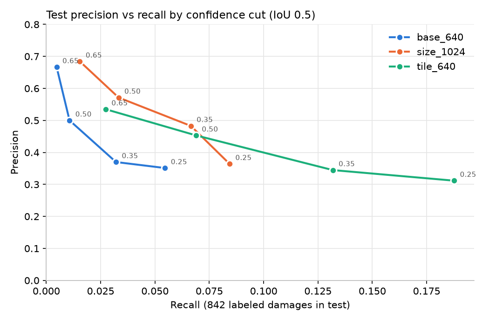
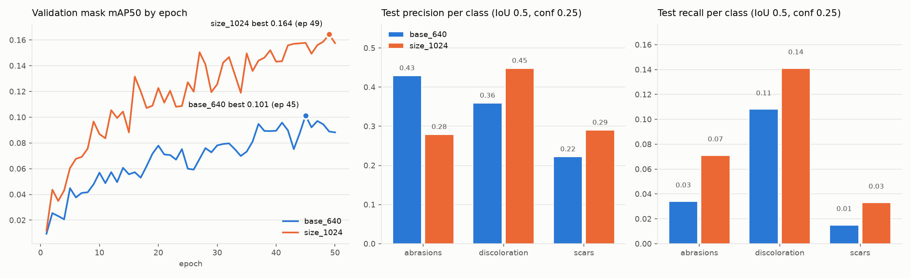

# sneaker-damage-seg: 운동화 손상 탐지 데이터셋·모델 파이프라인

운동화 사진에서 마모·변색·흠집을 찾는 분할(segmentation) 모델을 **데이터 점검 → 라벨 검수 → 누수 없는 분할 → 학습 → 오탐·누락 분석**까지 혼자 끝까지 만든 프로젝트입니다.
모델 점수를 올리는 것보다 **믿을 수 있는 데이터셋과 평가**를 만드는 데 집중했습니다.

## 한눈에 보기

| | |
|---|---|
| 데이터 | 공개 신발 결함 데이터 1,983장, 손상 다각형 5,736개 (3종: 마모·변색·흠집) |
| 기간 · 역할 | 2026.11 · 단독 (도구 개발, 실험 설계, Colab 학습, 분석) |
| 기술 | Python, COCO, YOLOv8-seg (Ultralytics), dHash, PIL, matplotlib, Google Colab |

**데이터에서 찾고 고친 것**
- **같은 신발이 학습과 시험에 섞이는 문제**: 파일 이름의 숫자가 신발 번호(597켤레)라는 걸 찾아 신발 단위로 나눴습니다. 번호가 달라도 같은 신발인 사진 36쌍은 이미지 해시로 찾아 합쳤고, 기준(거리 10)은 사진을 직접 비교해 정했습니다.
- **손상이 너무 작음**: 손상 면적 중앙값이 이미지의 0.03%라, 사진을 줄이면 손상이 사라진다는 가설을 세우고 실험으로 확인했습니다.
- **빠진 라벨**: 오탐 사진을 하나씩 보니 상당수가 실제 자국인데 라벨이 없었습니다. 숫자만 보고 모델을 탓하지 않고 원인을 평가 기준·빠진 라벨·진짜 오탐으로 나눴습니다.

**실험 결과** (test 309장, 손상 842개, IoU 0.5, conf 0.25)

| 실험 | 바꾼 것 | 찾은 손상 | 재현율 | 정밀도 |
|---|---|---:|---:|---:|
| base_640 | 기준 | 46 | 0.055 | 0.35 |
| size_1024 | 입력 크기 1024 | 71 | 0.084 | 0.36 |
| tile_640 | 원본을 640 조각으로 잘라 학습·추론 | **158** | **0.188** | 0.31 |



한 실험에 하나만 바꿨고, 모델 선택은 val로만, test는 실험마다 마지막에 한 번만 봤습니다. 타일 방식으로 재현율을 3.4배(0.055 → 0.188) 올렸지만 가죽 결의 작은 점까지 짚어 오탐도 늘었습니다. 그래서 "사람이 다시 확인하는 검사면 타일, 자동 판정이면 1024 + conf 0.35"처럼 쓰임에 따라 고르도록 정리했습니다. 상세 기록은 [docs/실험기록.md](docs/실험기록.md)에 있습니다.

**한계와 다음 단계**: 재현율이 아직 0.2 미만이라 실사용 수준은 아닙니다. 손상 없는 조각 비율을 늘려 오탐 줄이기(진행 중), 라벨 재검수 후 재평가, 학습 길이 늘리기를 다음 순서로 둡니다.

## 도구 구성

| 단계 | 도구 | 하는 일 |
|---|---|---|
| ① 데이터 정리 | `tools/import_roboflow.py`, `tools/audit.py` | 합치기, 중복·EXIF 회전·누락 파일·클래스 이름 변형·근접 중복 찾기 |
| ② 라벨 품질 관리 | `docs/라벨_기준서_초안.md` | 라벨 기준과 검수 순서 |
| ③ 학습 데이터 구성 | `tools/split.py`, `tools/coco2yolo.py`, `tools/tile_yolo.py` | 신발 단위 분할, YOLO 변환, 타일 자르기 |
| ④ 모델 개발 | `notebooks/train_colab.ipynb`, `tools/run_tile_experiment.py` | Colab 학습, 끊기면 이어서 |
| ⑤ 평가 | `tools/eval_report.py`, `tools/test_eval.py`, `tools/tiled_predict.py` | 클래스·크기별 TP/FP/FN, conf 기준표, 오탐 사진 모음 |

필요한 것: Python 3.10+, `pip install pillow numpy matplotlib` (학습은 Colab에서 `ultralytics`).

## 0. 가짜 데이터로 전체 흐름 먼저 보기 (GPU 없이 1분)

```bash
python tools/make_toy.py --out toy
python tools/audit.py --images toy/images --coco toy/annotations.json --out toy/reports/audit
python tools/split.py --coco toy/annotations.json --near-dups toy/reports/audit/near_duplicates.csv --out toy/splits
python tools/coco2yolo.py --splits toy/splits --images toy/images --out toy/yolo
```

가짜 데이터에는 일부러 넣은 문제 7가지가 있습니다. audit가 모두 잡아야 정상입니다.

| 넣어 둔 문제 | audit 결과 |
|---|---|
| 같은 파일 복사본 | `exact_duplicate` |
| 같은 신발을 다른 번호(S099)로 저장 | `near_duplicate_cross_group` → split에서 한 묶음으로 합침 |
| EXIF 회전 사진 | `exif_rotated` → 변환 때 바로 세움 |
| COCO에는 있는데 파일 없음 | `missing_on_disk` |
| 파일은 있는데 COCO에 없음 | `not_in_coco` |
| 클래스 이름 오타 `Sole Separation ` | `class_name_variant` |
| 신발 번호 없는 파일 이름 | `no_group` |

## 1. 실제 데이터 준비

1. `docs/촬영_가이드.md`대로 집에 있는 운동화를 찍습니다 (파일 이름 규칙 중요).
2. CVAT에서 `docs/라벨_기준서_초안.md`대로 다각형을 그리고 **COCO 1.0** 으로 내보냅니다.
3. `data/images/`와 `data/annotations.json`으로 정리한 뒤 0번 명령에서 `toy`를 `data`로 바꿔 실행합니다.
4. audit의 `error`는 모두 고치고 다음 단계로 갑니다. `warn`은 읽어 보고 판단합니다.

**공개 데이터로 시작하기:** Roboflow Universe의 [Segmentation of Shoe Defects](https://universe.roboflow.com/shoe-defect-detection/segmentation-of-shoe-defects)
(CC BY 4.0, 마모·변색·흠집 3종)를 **COCO Segmentation** 형식으로 내려받은 뒤:

```bash
python tools/import_roboflow.py --zip <내려받은 zip> --out data
```

Roboflow가 나눠 둔 train/valid/test를 하나로 합치고, 이 키트의 그룹·근접중복 기준으로 다시 나눕니다.
실제 클래스 이름은 `classes.txt`에 저장되어 모든 도구가 그 이름을 씁니다(지우면 기본 2종으로 돌아감).

## 실제 데이터 결과: Segmentation of Shoe Defects v16

공개 데이터([Roboflow Universe](https://universe.roboflow.com/shoe-defect-detection/segmentation-of-shoe-defects), CC BY 4.0)로 ①~③을 돌린 결과입니다.
원본 이미지와 라벨은 저장소에 포함하지 않습니다.

```bash
python tools/import_roboflow.py --zip "Segmentation of Shoe Defects.v16i.coco-segmentation.zip" \
    --out data --group-regex '^(?:back|front|side\d)_(\d+)'
python tools/audit.py --images data/images --coco data/annotations.json --out data/reports/audit
python tools/split.py --coco data/annotations.json \
    --near-dups data/reports/audit/near_duplicates.csv --max-hamming 10 --out data/splits
python tools/coco2yolo.py --splits data/splits --images data/images --out data/yolo
```

**데이터 규모:** 이미지 1,983장, 다각형 5,736개, 클래스 3종(abrasions 1,896 / discoloration 1,906 / scars 1,934). 라벨이 하나도 없는 이미지 707장.

### 발견 1. 파일 이름의 숫자가 신발 번호

Roboflow 파일 이름(`back_552_png.rf.….jpg`)의 숫자는 신발 번호입니다. `back_552`, `front_552`, `side1_552`, `side2_552`는 같은 신발을 네 방향에서 찍은 사진이고, 신발은 모두 597켤레입니다.
이 번호를 무시하고 사진 단위로 나누면 같은 신발이 학습(앞모습)과 시험(옆모습)에 동시에 들어가 점수가 부풀려집니다. 그래서 `--group-regex`로 번호를 그룹으로 씁니다.

### 발견 2. 번호만으로는 부족: 같은 신발이 다른 번호로도 저장됨

256비트 dHash 거리 10 이하인 36쌍은 **모두 서로 다른 번호**였습니다(예: `back_354`, `back_355`, `back_356`은 같은 신발의 연속 촬영).
사진을 직접 비교해 기준을 정했습니다.

| 거리 | 눈으로 본 결과 | 처리 |
|---|---|---|
| 0~8 | 같은 신발, 같은 각도 | 한 그룹으로 합침 |
| 9~11 | 같은 모델·같은 색이라 애매 | 누수 방지를 위해 합침 (`--max-hamming 10`) |
| 12 이상 | 색이 다른 다른 신발 | 합치지 않음 |

거리 20(기본값)을 그대로 쓰면 같은 모델의 다른 신발이 줄줄이 이어져 239장짜리 묶음이 생깁니다. 데이터마다 사진을 보고 기준을 정해야 합니다.

### 분할 결과

| 분할 | 이미지 | 신발 묶음 | abrasions | discoloration | scars |
|---|---:|---:|---:|---:|---:|
| train | 1,363 | 353 | 1,366 | 1,340 | 1,339 |
| val | 311 | 109 | 263 | 260 | 326 |
| test | 309 | 112 | 267 | 306 | 269 |

어떤 신발 번호도 두 분할에 걸치지 않습니다.

### 발견 3. 손상이 매우 작고, 빠진 라벨이 있음

- 손상 박스 면적은 이미지 면적의 중앙값 **0.03%**, 74%가 0.1% 미만입니다. 원본이 가로 3,000px 이상이라 `imgsz=640`으로 줄이면 많은 손상이 몇 픽셀만 남습니다. 입력 크기 비교 실험이 중요합니다.
- 라벨을 원본 위에 다시 그려 보면 위치는 정확하지만, 바로 옆의 비슷한 얼룩이나 큰 찢어짐이 라벨 없이 남은 사진이 있습니다. 모델이 이런 곳을 찾으면 평가상 오탐으로 잡히므로 오탐 사례는 사진을 직접 확인합니다.

### 모델 결과 (yolov8n-seg, 50 epoch): 입력 640 vs 1024



| | base_640 | size_1024 |
|---|---:|---:|
| val Mask mAP50 | 0.101 | **0.164** |
| test Mask mAP50 | 0.066 | **0.091** |
| test Box mAP50 | 0.073 | **0.120** |
| test 찾아낸 손상 (TP, 842개 중, conf 0.25) | 46 | **71** |
| test 오탐 (FP, conf 0.25) | 85 | 124 |

입력을 640에서 1024로 키우자 test mAP가 약 1.4~1.6배가 됐습니다. 손상이 작아서 축소하면 사라진다는 가설과 맞습니다.

**오탐을 사진으로 확인해 보니** 상당수가 라벨 위치는 맞혔지만 박스 크기가 달라 IoU 0.5를 못 넘은 경우이거나, 눈에 보이는 자국인데 라벨이 빠진 경우였습니다. IoU 0.3으로 다시 세면 오탐 124개 중 21개가 정답으로 바뀝니다. conf를 0.35로 올리면 오탐이 절반으로 줄고 정답은 20%만 줄어듭니다.
재현율은 여전히 0.1 안팎이라 원본을 잘라 축소 없이 학습하는 타일 방식을 시험했습니다.

### 모델 결과 3: 타일 학습 (640px 조각, 겹침 128px)

원본을 640px 조각으로 잘라 학습하고, test는 통사진을 같은 격자로 잘라 예측한 뒤 다시 붙입니다(`tools/run_tile_experiment.py`).


| test, IoU 0.5, conf 0.25 | base_640 | size_1024 | tile_640 |
|---|---:|---:|---:|
| 찾아낸 손상 (TP, 842개 중) | 46 | 71 | **158** |
| 재현율 | 0.055 | 0.084 | **0.188** |
| 오탐 (FP) | 85 | 124 | 349 |
| 정밀도 | 0.35 | **0.36** | 0.31 |
| 오탐이 나온 정상 사진 | 12장 | 18장 | 54장 |

- 타일 방식은 재현율을 1024의 **2.2배**로 올렸습니다. 특히 작은 흠집(scars)은 9개 → 35개를 찾았습니다.
- 대신 원본 해상도에서 보이는 가죽 결의 작은 점까지 짚어 오탐이 크게 늘었습니다.
- 같은 재현율(약 0.07)에서는 1024가 정밀도가 약간 높습니다(0.48 vs 0.45). 사람이 다시 확인하는 검사면 tile, 자동 판정이면 1024가 맞습니다.

자세한 내용은 [docs/실험기록.md](docs/실험기록.md)에 있습니다.

그림은 `tools/plot_results.py`로 다시 그릴 수 있습니다.

```bash
python tools/plot_results.py --run base_640 runs/base_640/results.csv runs/base_640_report/summary.txt \
    --run size_1024 runs/size_1024/results.csv runs/size_1024_report/summary.txt --out compare.png
python tools/plot_conf_sweep.py --sweep runs/conf_sweep.json --out conf_sweep.png
```

## 2. Colab에서 학습 (④)

`notebooks/train_colab.ipynb`를 Colab(GPU)에서 위에서부터 실행합니다. 데이터는 Drive에 7MB 조각으로 올려 두고 노트북이 합친 뒤 SHA256으로 확인합니다. 학습 결과는 Drive에 저장되어 런타임이 끊겨도 남습니다.

타일 실험은 한 줄로 자르기 → 학습 → 통사진 예측 → 평가까지 돌고, 끊기면 마지막 epoch부터 이어 갑니다.

```bash
python tools/run_tile_experiment.py --runs /content/drive/MyDrive/sneaker-damage-seg/runs
python tools/run_tile_experiment.py --runs ... --empty-ratio 0.6   # 손상 없는 조각을 더 많이
```

## 3. 실험 규칙

- 한 번에 하나만 바꿉니다. 모델 선택은 `val`로만 하고, `test`는 실험마다 마지막에 한 번만 봅니다.
- 타일 학습의 val 점수는 조각 단위라 다른 실험과 비교하지 않습니다. 비교는 test 통사진 기준 `eval_report.py`와 conf 기준표로 합니다.
- 결과는 [docs/실험기록.md](docs/실험기록.md)에 실험 이름, 바꾼 것, seed, val, test 순으로 남깁니다.

## 4. 알아 둘 점

- `eval_report.py`는 다각형의 **박스**로 매칭합니다. 가늘고 긴 손상(흠집 등)은 박스가 몇 픽셀만 어긋나도 IoU가 크게 떨어지므로, 공식 지표는 ultralytics `val`의 mask mAP를 쓰고 이 리포트는 어떤 사진이 틀렸는지 찾는 용도로 씁니다.
- 근접 중복 거리는 256비트 해시 중 다른 비트 수입니다. 이 데이터에서는 사진을 직접 비교해 10으로 정했습니다(`split.py --max-hamming 10`). 데이터가 바뀌면 `near_duplicates.csv`를 몇 쌍 열어 보고 다시 정합니다.
- 자동 초안(GPT·SAM) 라벨은 사람 검수 전까지 test에 넣지 않습니다.
