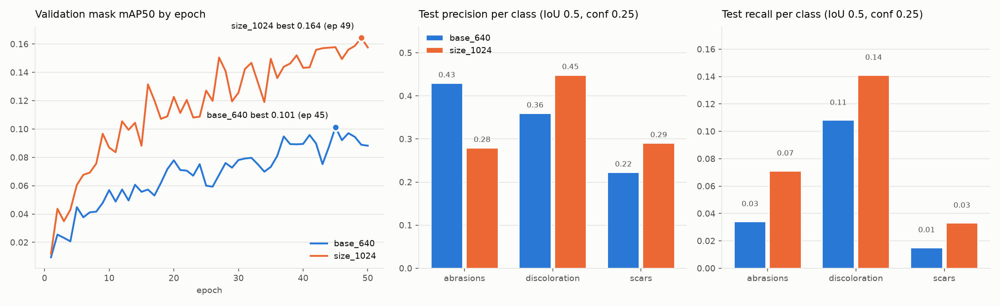
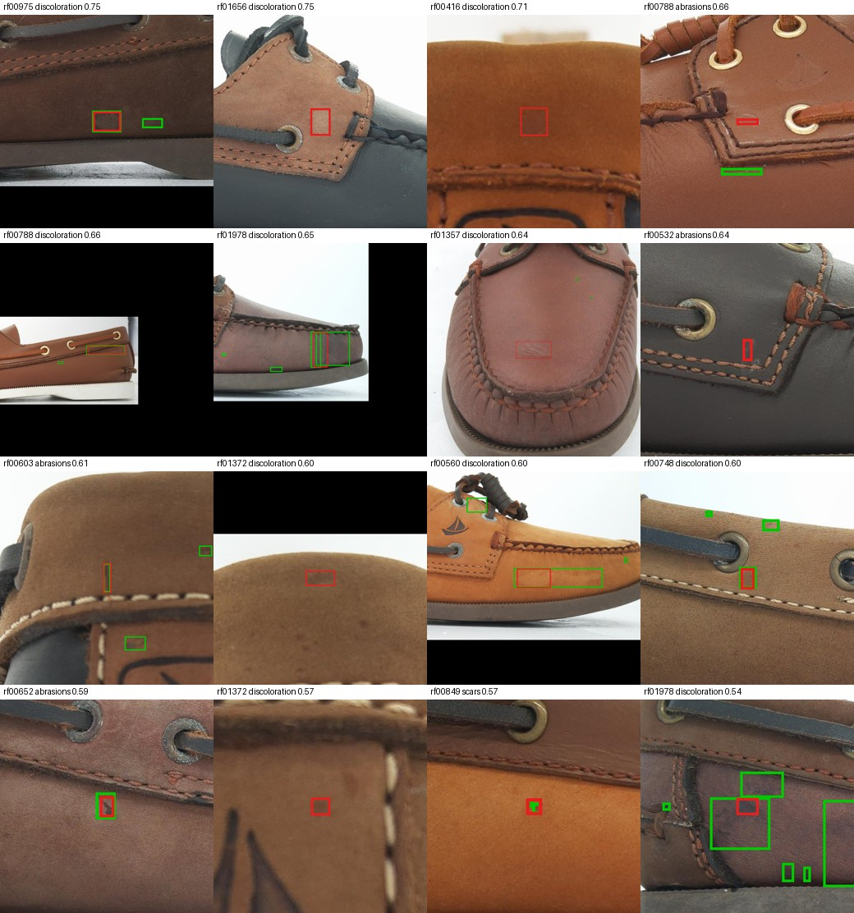
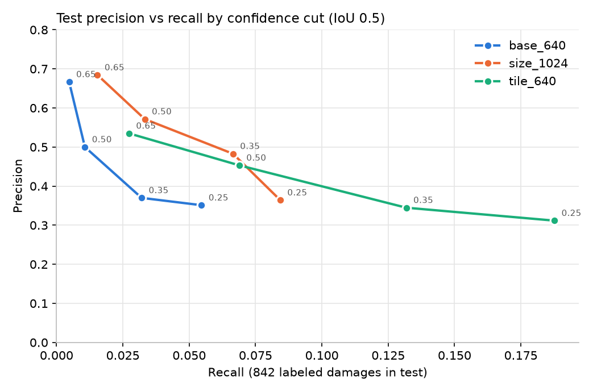
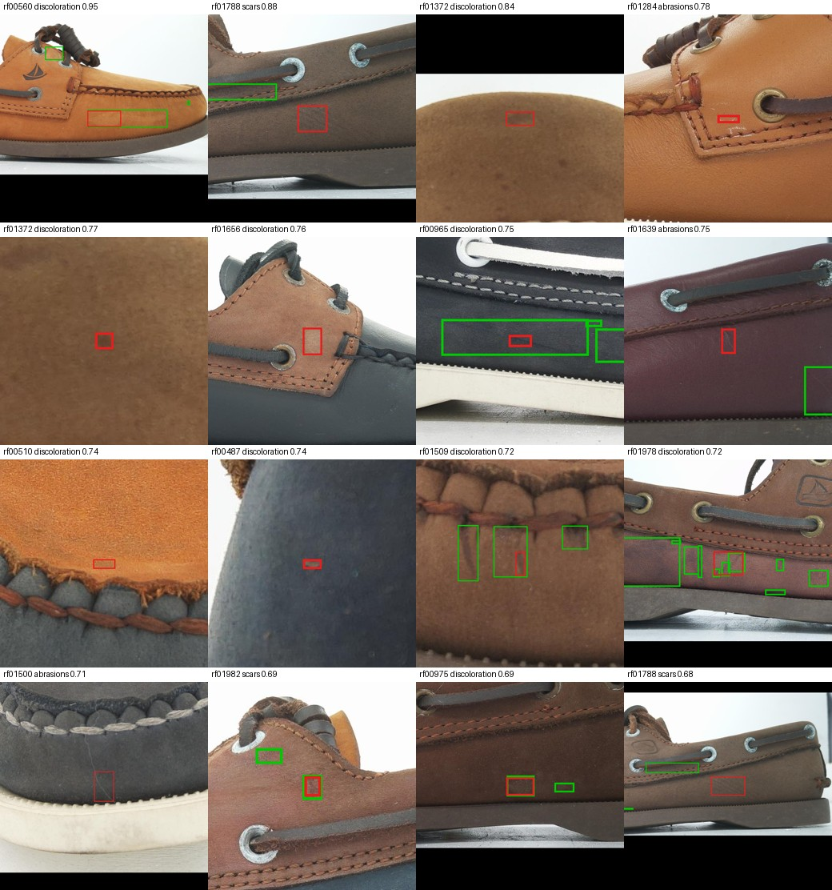

# 실험 기록

데이터: Segmentation of Shoe Defects v16, 신발 단위 분할(train 1,363 / val 311 / test 309장), 이미지 긴 변 1,600px로 축소.
환경: Google Colab T4, Ultralytics 8.4.215, PyTorch 2.14.
규칙: 모델 선택은 val로만, test는 실험마다 마지막에 한 번.

## 실험 1: base_640 (2026-11-19)

| 항목 | 값 |
|---|---|
| 모델 | yolov8n-seg (COCO 사전학습) |
| 설정 | imgsz=640, epochs=50, batch=16, seed=0, deterministic=True, 기본 증강 |
| 학습 시간 | 약 31분 (epoch당 약 37초) |
| best val epoch | 45 (mask mAP50 기준) |

### val (311장, best epoch)

| 지표 | Box | Mask |
|---|---:|---:|
| mAP50 | 0.106 | 0.101 |
| mAP50-95 | 0.039 | 0.035 |
| Precision | – | 0.228 |
| Recall | – | 0.155 |

### test (309장, 842개 손상)

| 클래스 | Box mAP50 | Mask mAP50 | Mask Recall |
|---|---:|---:|---:|
| 전체 | 0.073 | 0.066 | 0.137 |
| abrasions | 0.067 | 0.057 | 0.105 |
| discoloration | 0.123 | 0.095 | 0.209 |
| scars | 0.029 | 0.046 | 0.097 |

전체 Mask mAP50-95 0.020, Box mAP50-95 0.022.

### 오탐·누락 분석 (`eval_report.py`, IoU 0.5, conf 0.25, 박스 기준)

| 클래스 | TP | FP | FN | Precision | Recall |
|---|---:|---:|---:|---:|---:|
| abrasions | 9 | 12 | 258 | 0.429 | 0.034 |
| discoloration | 33 | 59 | 273 | 0.359 | 0.108 |
| scars | 4 | 14 | 265 | 0.222 | 0.015 |

- 사진별: 누락이 있는 사진 179장, 정상(라벨 없는) 사진의 오탐 12장, 완전히 맞힌 사진 117장.
- 손상 크기별 recall: 작은 손상(이미지의 0.5% 미만)이 대부분인데 abrasions 7/238, scars 4/262만 찾음.

### 해석

- **가장 큰 문제는 누락입니다.** 정밀도는 0.2~0.4인데 재현율이 0.02~0.2로 훨씬 낮습니다. 원본(3,000px 이상)을 640px로 줄이면서 면적 중앙값 0.03%짜리 손상이 몇 픽셀만 남기 때문으로 보입니다.
- discoloration(변색)이 가장 낫습니다. 색 차이는 축소해도 남지만, 긁힘(scars)처럼 가는 선은 사라집니다.
- val mAP50은 마지막 epoch까지 오르고 있어(0.09 → 0.10) 50 epoch가 충분하지 않았을 수 있습니다.
- 라벨 누락이 있는 데이터라 FP 일부는 실제 손상일 수 있습니다. 정상 사진 오탐 12장은 사진을 직접 볼 필요가 있습니다.
- val(0.101)과 test(0.066)의 차이가 큽니다. 신발 단위로 나눠서 같은 신발이 섞이지 않은 결과이고, 한 번의 seed라 차이의 일부는 표본 변동입니다.

## 실험 2: size_1024 (2026-11-23)

입력 크기만 1024로 바꾸고 나머지는 실험 1과 같습니다(batch=8). 학습 약 56분.
(11-19에 9 epoch에서 한 번 중단했고, 다시 처음부터 50 epoch를 돌린 결과입니다.)

### val (311장, best epoch)

| 지표 | base_640 (ep 45) | size_1024 (ep 49) | 변화 |
|---|---:|---:|---:|
| Mask mAP50 | 0.101 | **0.164** | +62% |
| Mask mAP50-95 | 0.035 | **0.055** | +59% |
| Box mAP50 | 0.105 | **0.175** | +66% |
| Mask Precision | 0.231 | 0.305 | |
| Mask Recall | 0.155 | 0.216 | |

### test 오탐·누락 분석 (`eval_report.py`, IoU 0.5, conf 0.25)

| 클래스 | 640 TP / FP / FN | 1024 TP / FP / FN | 640 recall | 1024 recall |
|---|---|---|---:|---:|
| abrasions | 9 / 12 / 258 | 19 / 49 / 248 | 0.034 | 0.071 |
| discoloration | 33 / 59 / 273 | 43 / 53 / 263 | 0.108 | 0.141 |
| scars | 4 / 14 / 265 | 9 / 22 / 260 | 0.015 | 0.033 |
| 합계 | 46 / 85 / 796 | **71** / 124 / 771 | 0.055 | **0.084** |

- 작은 손상(이미지의 0.5% 미만) recall: abrasions 7 → 14개, discoloration 30 → 37개, scars 4 → 9개.
- 정상 사진 오탐은 12장 → 18장으로 늘었습니다.
### test mAP (Ultralytics `val split=test`, 2026-11-23 `tools/test_eval.py`)

| 지표 | base_640 | size_1024 |
|---|---:|---:|
| Mask mAP50 | 0.066 | **0.091** |
| Mask mAP50-95 | 0.020 | **0.032** |
| Box mAP50 | 0.073 | **0.120** |
| Mask mAP50: abrasions / discoloration / scars | 0.057 / 0.095 / 0.046 | 0.073 / 0.129 / 0.071 |

## 오탐 분석 (2026-11-23)

### conf 기준을 바꾸면 (test, IoU 0.5)

| conf | 640 TP / FP | 640 정밀도 | 1024 TP / FP | 1024 정밀도 | 1024 재현율 | 1024 정상 사진 오탐 |
|---:|---|---:|---|---:|---:|---:|
| 0.25 | 46 / 85 | 0.35 | 71 / 124 | 0.36 | 0.084 | 18장 |
| 0.35 | 27 / 46 | 0.37 | 56 / 60 | 0.48 | 0.067 | 7장 |
| 0.50 | 9 / 9 | 0.50 | 28 / 21 | 0.57 | 0.033 | 2장 |
| 0.65 | 4 / 2 | 0.67 | 13 / 6 | 0.68 | 0.015 | 1장 |

기준을 0.35로 올리면 1024 모델의 오탐이 절반(124 → 60)으로 줄고 정답은 71 → 56개로 조금만 줄어듭니다. 같은 conf에서 1024가 640보다 항상 정답이 많습니다.

### 신뢰도가 가장 높은 오탐 16개

초록은 라벨, 빨강은 라벨과 맞지 않은 예측입니다. 사진을 하나씩 보면 세 종류입니다.

| 종류 | 개수 (16개 중) | 예 |
|---|---:|---|
| 라벨 위치는 맞혔지만 박스 크기가 달라 IoU 0.5 미달 | 약 7 | rf00652, rf00849, rf01978, rf00560 |
| 눈에 보이는 얼룩·자국인데 라벨이 없음 | 약 6 | rf01372, rf00416, rf00748, rf01357 |
| 실제 오탐으로 보임 | 약 3 | rf00788 |

IoU 기준을 0.3으로 낮추면 1024 모델(conf 0.25)의 정답이 71 → **92**, 오탐이 124 → **103**으로 바뀝니다. 오탐 124개 중 21개는 위치를 맞혔지만 박스 크기가 달랐던 경우입니다. 손상이 작을수록 몇 픽셀 차이로 IoU가 크게 떨어집니다.

### 정리

- **오탐 숫자의 상당 부분은 모델보다 평가 조건과 라벨 때문입니다.** 작은 손상에 대한 IoU 0.5 기준과 빠진 라벨이 오탐을 부풀립니다.
- 실제 사용에서는 conf 0.35 정도가 균형점입니다(정밀도 0.48, 정상 사진 오탐 7장).
- 라벨을 보완하면 평가가 더 정확해집니다. 오탐 사례 중 라벨이 빠진 사진은 재검수 후보로 따로 모읍니다.

### 해석

- **입력을 키우자 거의 모든 지표가 1.5배 이상 좋아졌습니다.** 작은 손상이 축소로 사라진다는 실험 1의 가설과 맞습니다.
- 찾아낸 손상(TP)이 46 → 71개로 늘었지만 오탐도 85 → 124개로 늘었습니다. 특히 abrasions 정밀도는 0.43 → 0.28로 떨어졌습니다. 더 많이 찾는 대신 헷갈리는 곳도 더 짚습니다.
- 그래도 재현율은 여전히 0.1 안팎이라, 손상 대부분을 놓칩니다. 1024로도 부족합니다.
- val 곡선이 50 epoch까지 계속 오르고 있어 학습을 더 길게 하면 더 오를 여지가 있습니다.

## 실험 3: tile_640 (2026-11-23)

원본을 줄이지 않고 640px 조각(겹침 128px)으로 잘라 학습했습니다. 모델·epoch·seed는 실험 1과 같습니다.

- 학습: train 1,363장 → 조각 4,002개(손상 없는 조각은 30%만 남겨 1,481개), val 311장 → 915개.
- 추론: test는 통사진 그대로 두고, 같은 격자로 잘라 예측한 뒤 원본 좌표로 되돌리고 겹친 예측은 클래스별 NMS로 하나만 남깁니다(`tools/tiled_predict.py`).
- 학습 중 val 점수는 조각 단위라 실험 1·2와 비교하지 않습니다. 비교는 test 통사진 기준 `eval_report.py`와 conf 기준표로만 합니다.
- 42 epoch에서 Colab 연결이 끊겨 `last.pt`에서 이어 학습했습니다(`run_tile_experiment.py`는 이제 results.csv의 epoch 수로 완료 여부를 판단).

### test 오탐·누락 (IoU 0.5, conf 0.25)

| 클래스 | 1024 TP / FP / FN | tile TP / FP / FN | 1024 recall | tile recall |
|---|---|---|---:|---:|
| abrasions | 19 / 49 / 248 | 56 / 118 / 211 | 0.071 | **0.210** |
| discoloration | 43 / 53 / 263 | 67 / 140 / 239 | 0.141 | **0.219** |
| scars | 9 / 22 / 260 | 35 / 91 / 234 | 0.033 | **0.130** |
| 합계 | 71 / 124 / 771 | **158** / 349 / 684 | 0.084 | **0.188** |

- 작은 손상(이미지의 0.5% 미만) 정답: abrasions 14 → 47개, discoloration 37 → 61개, scars 9 → 35개.
- IoU 0.3으로 세면 tile은 정답 202개, 오탐 305개(재현율 0.24)입니다.
- 정상 사진(라벨 없음) 중 오탐이 있는 사진: 18장 → 54장.

### conf 기준별 비교 (test, IoU 0.5)

| conf | 1024 TP / FP | 1024 정밀도 | tile TP / FP | tile 정밀도 | tile 재현율 | tile 정상 사진 오탐 |
|---:|---|---:|---|---:|---:|---:|
| 0.25 | 71 / 124 | 0.36 | 158 / 349 | 0.31 | 0.188 | 54장 |
| 0.35 | 56 / 60 | 0.48 | 111 / 211 | 0.34 | 0.132 | 39장 |
| 0.50 | 28 / 21 | 0.57 | 58 / 70 | 0.45 | 0.069 | 13장 |
| 0.65 | 13 / 6 | 0.68 | 23 / 20 | 0.53 | 0.027 | 6장 |

### 신뢰도가 가장 높은 오탐 16개

| 종류 | 개수 (16개 중) | 예 |
|---|---:|---|
| 라벨 안이나 옆을 짚었지만 박스 크기가 달라 IoU 미달 | 약 6 | rf00560, rf00965, rf01509, rf01978 |
| 매끈한 가죽 위 작은 점·얼룩 (라벨 없음, 진짜 자국인지 애매) | 약 7 | rf01372, rf00510, rf00487, rf01639 |
| 실제 오탐 (주름·구김 등) | 약 3 | rf01788, rf01500 |

### 해석

- **재현율이 1024의 2.2배(0.084 → 0.188)가 됐습니다.** 축소 없이 보면 작은 손상을 훨씬 많이 찾습니다. 특히 scars는 9 → 35개로 가장 크게 늘었습니다.
- **대신 오탐이 크게 늘었습니다(124 → 349).** 원본 해상도에서는 가죽 결의 작은 점까지 보이므로 모델이 이런 점을 손상으로 짚습니다. 정상 사진 오탐도 3배입니다.
- **같은 재현율에서는 1024가 약간 낫습니다.** 재현율 0.07 부근에서 1024(conf 0.35) 정밀도 0.48, tile(conf 0.5) 0.45입니다. tile의 장점은 1024가 도달할 수 없는 재현율 구간(0.13~0.19)까지 곡선을 늘린 것입니다.
- 실제 쓰임에 따라 고릅니다: 놓치면 안 되는 검사(사람이 다시 확인)면 tile + 낮은 conf, 자동 판정이면 1024 + conf 0.35~0.5.
- 타일 하나를 640으로 넣으므로 추론 비용은 사진당 조각 수(약 6개)만큼 늘어납니다.

## 다음 실험 후보

1. **오탐 줄이기**: 손상 없는 조각 비율을 30% → 60%로 늘려 tile 재학습 (정상 가죽을 더 보여 주기)
2. epoch 100으로 늘리기 (세 실험 모두 끝까지 오르는 중)
3. 오탐 사진 중 라벨이 빠진 것으로 보이는 사례를 모아 라벨 재검수 후 재평가
4. tile + 1024 예측을 합치기(작은 손상은 tile, 큰 손상은 통사진)
